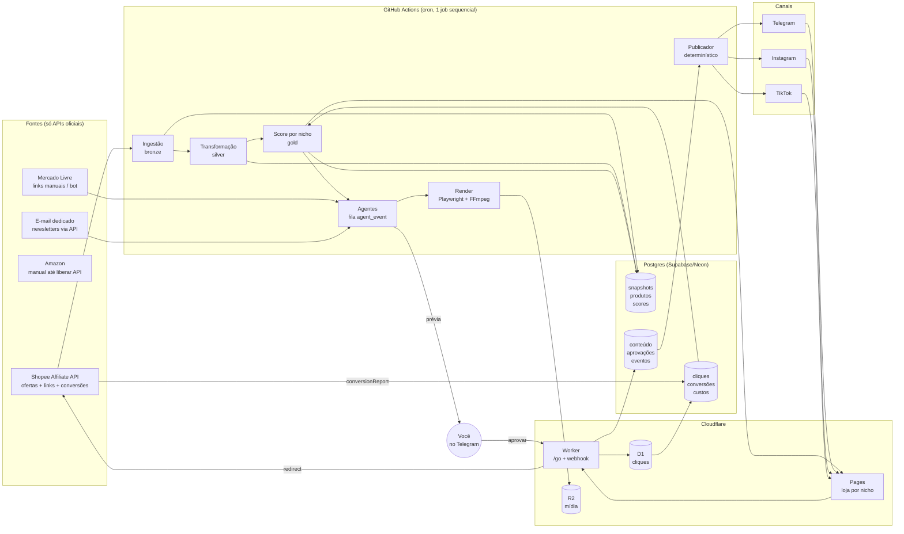
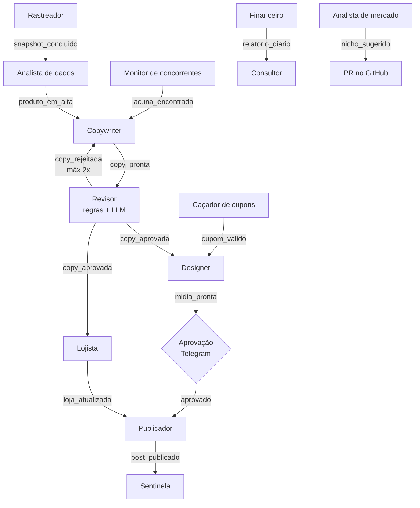

# Arquitetura — Garimpo (negócio de afiliados multi-nicho)

> Documento de referência que fica ao lado do [prompt-garimpo-engine.md](prompt-garimpo-engine.md).
> O prompt diz **como construir**. Este documento diz **como o sistema gera dinheiro**, como as peças se encaixam, onde estão os limites do plano gratuito e em que ordem construir para faturar o quanto antes.

---

## 0. Fonte da verdade

- **Código:** a versão 0.1 está implementada neste repositório. Comece pelo [README.md](README.md).
- **Especificação:** [prompt-garimpo-engine.md](prompt-garimpo-engine.md), já com as correções da seção 7 e o estado atual.
- **Configuração:** [config/niches.yaml](config/niches.yaml) é a fonte da verdade dos nichos.
- O antigo `prompt-achadinhos-engine.md` (ids `pets`, `carros`, `maquiagem` inconsistentes) foi arquivado em [docs/archive/](docs/archive/prompt-achadinhos-engine.md) e não deve ser usado.

---

## 1. Tese de negócio

Afiliado de achadinhos ganha dinheiro com uma conta simples:

```
Receita = Alcance × CTR × Conversão × Ticket médio × Comissão
```

| Alavanca | O que o sistema faz para aumentá-la |
|---|---|
| **Alcance** | Vários nichos ao mesmo tempo, cada um com Instagram, TikTok e Telegram; constância de postagem sem trabalho manual |
| **CTR** (clique / visualização) | Criativo com a marca do nicho, preço com desconto real, cupom em destaque, horário certo |
| **Conversão** (venda / clique) | Só produto com nota ≥ 4,5, muitas avaliações e vendas em aceleração; link direto para o app da loja |
| **Ticket × Comissão** | Score pondera comissão; o Analista de mercado move o esforço para nichos com comissão média maior |

O ponto que mais importa: **o gargalo é tráfego, não tecnologia.** O sistema existe para (1) produzir conteúdo bom em volume sem custo de tempo e (2) medir o que converte para dobrar a aposta nisso. Toda decisão de arquitetura abaixo serve a esses dois objetivos.

### Ordem de grandeza (hipotética, para calibrar metas)

| Cenário | Cliques/dia (todos os nichos) | Conversão | Ticket | Comissão | Receita/mês |
|---|---|---|---|---|---|
| Início (mês 1–2) | 100 | 3% | R$ 60 | 7% | ~R$ 380 |
| Tração (mês 3–6) | 1.000 | 3% | R$ 60 | 7% | ~R$ 3.800 |
| Escala (6+ nichos) | 5.000 | 3% | R$ 70 | 7% | ~R$ 22.000 |

Os números de conversão e comissão variam muito por categoria e campanha. Substitua pelos seus dados reais a partir da semana 2 — o relatório diário (Financeiro) faz exatamente essa conta.

---

## 2. Visão geral



**Fluxo do dinheiro:** post → clique em `/go` (registrado sem IP) → redirect para o link de afiliado com `sub_id` → compra → relatório de conversão da Shopee volta com o mesmo `sub_id` → score aprende o que vende.

---

## 3. Camadas

### 3.1 Ingestão (bronze)
- **Shopee Affiliate Open API (GraphQL):** busca de ofertas por palavra-chave e categoria, geração de link curto com até 5 `subIds`, relatório de conversões. É a fonte principal e a única 100% automatizável hoje.
- **Mercado Livre:** sem API pública de geração de link de afiliado. Fluxo: você gera o link no painel e cola no bot (`/ml <link>`); o sistema completa dados públicos do item pela API pública do ML (preço, título, foto) e trata como qualquer produto.
- **Amazon:** a API de produtos exige vendas qualificadas antes de liberar acesso. Comece manual (mesmo fluxo do ML) e automatize quando liberar.
- `raw_offer_snapshot` guarda o payload bruto por `run_date`; tudo a jusante pode ser recalculado a partir dele (idempotência e reprocessamento).

### 3.2 Transformação e score (silver → gold)
- `product_daily` com `sales_total` por dia → vendas em 1/7/15/30 dias por diferença.
- `price_history` (SCD2) detecta **desconto falso** (preço inflado antes da "promoção") — o componente `real_discount` do score usa a mediana de 30 dias, não o "de/por" do anúncio.
- Score por nicho com os pesos do YAML. O componente `my_channel` só entra depois de 50 cliques para não premiar ruído.
- **Exploração vs. exploração:** reserve ~20% dos slots de conteúdo para produtos novos de score médio (estratégia ε-greedy). Sem isso o sistema fica preso nos mesmos produtos e nunca descobre o próximo campeão.

### 3.3 Decisão e conteúdo (agentes)
Os agentes conversam por eventos na tabela `agent_event`; cada um é uma função pura com entrada e saída Pydantic. LLM só escreve texto e classifica; **nunca** decide ranking, preço ou publicação.



**Custo de LLM:** cada copy custa frações de centavo com modelo pequeno/médio. Com teto de US$ 0,30/dia por nicho, o custo cabe em ~US$ 20–30/mês para 2–3 nichos. Use cache de prompt para as instruções fixas (marca, regras de conformidade), que se repetem em toda chamada.

### 3.4 Aprovação (humano no loop)
- Prévia no seu chat privado com o bot: imagem, legenda, score, motivo da escolha e botões **Aprovar / Rejeitar / Reagendar**.
- **Hoje (v0.1):** cada execução agendada começa lendo as respostas (`getUpdates`); os botões são assinados com HMAC e só o seu `user_id` vale ([ADR 0002](docs/adr/0002-aprovacao-por-polling.md)). O botão confirma na próxima execução.
- **Depois:** o webhook do Telegram cai no Worker, que valida o segredo e o seu `user_id` e grava a decisão no banco com um papel próprio (`app_webhook`, que só insere em `approval` e `audit_log`).
- **Meta de tempo:** aprovar o dia inteiro em menos de 5 minutos. Se passar disso, o gargalo é você — ligue `auto_above_score` no nicho mais maduro.

### 3.5 Distribuição

| Canal | Papel no funil | Observações da API |
|---|---|---|
| **Telegram** | Conversão (público já comprador, clique direto) | Bot como admin do canal; sem restrição relevante. **Canal que fatura primeiro.** |
| **Instagram** | Alcance e marca (reels e stories) | Content Publishing API exige conta profissional ligada a página do Facebook; mídia em URL pública (R2); limite diário de posts por conta; link só na bio e em stories |
| **TikTok** | Alcance (vídeo) | App não auditado só envia como privado/rascunho. Conte com **rascunho + publicação manual pelo app** até a auditoria |
| **Loja (Pages)** | Página de bio, SEO de cauda longa, prova de confiança | Estática, rebuild após score; links `rel="sponsored nofollow"` |

### 3.6 Conversão e medição
- `/go/<nicho>/<canal>/<produto>` no Worker: valida parâmetros, busca o destino no KV (allowlist de domínios), registra o clique e redireciona.
- `sub_id` = `<nicho>-<canal>-<content_id>`. Com o `content_id` você sabe **qual post** vendeu, não só qual canal — é isso que permite o Consultor recomendar formato, horário e tipo de produto com base em dados.
- Conversões: importação diária via relatório de conversão da Shopee; ML e Amazon por CSV exportado do painel (comando `/importar` no bot).

### 3.7 Descoberta (crescimento)
- **Caçador de cupons** 3×/dia — cupom é o conteúdo de maior CTR em achadinhos.
- **Analista de mercado** semanal — decide qual `candidate` vira `active` com base em números, e abre PR.
- **Monitor de concorrentes** — encontra produtos em alta que você ainda não postou.

---

## 4. Rotina diária

Horários em America/Sao_Paulo. O cron do GitHub Actions é em UTC e **pode atrasar de minutos a mais de uma hora em horários cheios** — agende em minutos "quebrados" (ex.: `:07`, `:37`) e trate o slot como janela, não como horário exato.

| Horário | Workflow | O que acontece |
|---|---|---|
| 05:07 | `daily.yml` ✅ | Ingestão de todos os nichos → score → conteúdo → arte → prévias no seu Telegram |
| 06:00–07:30 | — | Você aprova no celular |
| 08:07, 12:07, 19:07, 21:07 | `publish.yml` ✅ | Lê aprovações e publica o que estiver aprovado com horário ≤ agora |
| 22:37 | `report.yml` ✅ | Cliques (D1), conversões, relatório no Telegram |
| Seg 06:17 | `security.yml` ✅ | gitleaks, pip-audit, npm audit, semgrep, inventário de segredos |
| 09:37, 15:37, 20:37 | `coupons.yml` ⏳ | Caçador de cupons; cupom bom vira prévia com prioridade alta |
| Dom 10:07 | `market.yml` ⏳ | Analista de mercado + Monitor de concorrentes |
| Semanal | `token-refresh.yml` ⏳ | Renovação do token do Instagram |

---

## 5. Orçamento do plano gratuito

| Serviço | Limite gratuito | Uso estimado (2 nichos) | Atenção |
|---|---|---|---|
| **GitHub Actions** (repo privado) | 2.000 min/mês | ~700 min/mês | Cada nicho a mais soma ~120–150 min/mês (render de vídeo é o maior custo). Teto prático: **~8–10 nichos**. Cache de Playwright, `uv` e FFmpeg é obrigatório |
| **Supabase** | 500 MB, pausa após 7 dias sem uso | < 100 MB | A execução diária evita a pausa. Retenção de 60 dias no bronze é essencial |
| **Neon** (alternativa) | 0,5 GB | idem | Sem pausa de projeto, mas com cold start |
| **Cloudflare Workers** | 100 mil req/dia | < 5 mil | Folga grande |
| **Cloudflare KV** | 100 mil leituras e **1 mil escritas/dia** | leituras ok | **Não grave cliques no KV** — use KV só para o mapa de redirects |
| **Cloudflare D1** | 100 mil escritas/dia, 5 GB | cliques | Grave cliques no D1; o pipeline diário copia para o Postgres e limpa |
| **Cloudflare Pages** | 500 builds/mês | ~60 (2 nichos × 1/dia) | Com 8 nichos chega a ~240; rebuild só quando a loja mudou |
| **Cloudflare R2** | 10 GB, egress grátis | ~2 GB | Apague mídia publicada há mais de 30 dias |
| **LLM** | pago | ~US$ 0,30/dia/nicho | Único custo; teto por nicho e global |

**Outros custos reais (fora da infraestrutura):** domínio `.com.br` (~R$ 40/ano) e, opcionalmente, impulsionamento de posts quando o Sentinela indicar um vencedor.

---

## 6. Segurança (resumo)

O prompt já cobre bem. Pontos que esta arquitetura acrescenta:

- **Papel `app_webhook`** para o Worker, só com `INSERT` em `approval` e `audit_log`. O Worker nunca recebe a credencial do `app_writer`.
- **Conexão Worker → Postgres** via driver HTTP do provedor (Neon serverless ou API do Supabase com chave restrita) ou Hyperdrive, nunca com a string de conexão do pipeline.
- **Botões de aprovação** carregam um id opaco assinado (HMAC) e com validade, não o id interno do conteúdo — evita aprovação por replay ou por id adivinhado.
- **D1 de cliques** sem IP, sem user-agent completo; só nicho, canal, conteúdo, timestamp e país (do header da Cloudflare).

---

## 7. Ajustes recomendados ao prompt

Todos incorporados ao [prompt-garimpo-engine.md](prompt-garimpo-engine.md):

1. ✅ **Cliques no D1, não no KV** (limite de 1 mil escritas/dia no KV). Implementado no Worker.
2. ✅ **Assinatura HMAC nos botões do Telegram** (implementado). Papel `app_webhook`: previsto para quando o webhook existir.
3. ✅ **`subIds` com `content_id`** (`[nicho, canal, content_id]`). Implementado.
4. ✅ **Exploração de 20%** nos slots de conteúdo para produtos novos. Implementado.
5. ✅ **TikTok como rascunho por padrão** até a auditoria do app. Fase 3 do prompt.
6. ✅ **Cron com minutos quebrados** e publicador que publica tudo que estiver aprovado com horário ≤ agora. Implementado.
7. ✅ **Importação de conversões** já na Fase 2. Implementado (Shopee e CSV).
8. ✅ **Fases reordenadas para receita** (seção 8).

---

## 8. Roadmap orientado a receita

As 7 fases do prompt estão em ordem de engenharia. Reordenadas para **o primeiro real entrar em ~2 semanas**:

| Etapa | Entrega | Por que nessa ordem | Meta de negócio |
|---|---|---|---|
| **0. Validação manual** (3–5 dias, sem código) | Cadastro na Shopee Afiliados, canais `@garimpocasa` e `@garimpopet` no Telegram, 3 posts/dia manuais com link gerado no painel | Confirmar que o nicho clica antes de automatizar | Primeiros 50 membros e primeiros cliques |
| **1. Fundação + segurança** | Fase 1 do prompt | Base obrigatória | — |
| **2. Dados + Telegram** | Fase 2 + publicador **só do Telegram** + aprovação + `/go` + importação de conversões | Telegram é o canal que converte mais rápido; fecha o ciclo post → clique → venda | **Primeira comissão automatizada** |
| **3. Conteúdo visual** | Fase 4 (templates, copy, Revisor) | Arte melhora CTR no Telegram e prepara Instagram | CTR ≥ 3% no Telegram |
| **4. Instagram + TikTok** | Fase 5 | Alcance para crescer os canais | 1.000 seguidores por nicho |
| **5. Lojas** | Fase 3 | Bio e SEO são aceleradores, não fundação | Página de bio com CTR ≥ 10% |
| **6. Cupons + relatórios** | Fase 6 | Cupons são o conteúdo de maior CTR | Relatório diário guiando decisões |
| **7. Expansão** | Fase 7 | Só escale nicho com o processo provado em 2 | 3º nicho ativo |

---

## 9. Indicadores (o que o relatório diário precisa mostrar)

| Indicador | Por nicho e canal | Sinal de alerta |
|---|---|---|
| Cliques / post | sim | queda de 30% na semana |
| CTR (cliques / alcance) | sim | < 1% no Instagram, < 3% no Telegram |
| Conversão (pedidos / cliques) | sim | < 1,5% |
| Comissão por clique (EPC) | sim | métrica-mãe para comparar nichos |
| Receita e comissão estimada vs. confirmada | sim | comissão cancelada > 20% |
| Crescimento de seguidores/membros | sim | estagnado por 2 semanas |
| Custo de LLM / receita | global | > 10% |
| Tempo de aprovação diário | global | > 10 min |
| Minutos do Actions no mês | global | > 1.600 |

**EPC (comissão por clique)** é o número que decide tudo: qual nicho promover, qual produto repetir, onde impulsionar.

---

## 10. Riscos

| Risco | Impacto | Mitigação |
|---|---|---|
| Mudança de regras ou comissão da Shopee | Receita cai de uma vez | Mercado Livre e Amazon como segunda e terceira fonte; score ajusta sozinho pela comissão |
| Conta de Instagram/TikTok restrita | Perda do canal | Só API oficial, limites conservadores, circuit breaker; Telegram e loja são ativos seus |
| Conteúdo genérico, parecido com o de todo mundo | CTR baixo | Identidade visual forte, vídeo de demonstração, cupom; Consultor mede o que funciona |
| Desconto falso ou produto ruim | Perda de confiança e devoluções (comissão cancelada) | `price_history`, filtro de nota e avaliações, Revisor |
| Estourar o plano gratuito | Pipeline para | Tabela da seção 5 monitorada no relatório |
| Fiscal | Problema com a Receita | Comissão é renda: avalie MEI ou CNPJ quando passar a ter receita recorrente (consulte um contador) |
| Publicidade sem identificação | Sanção do CONAR / plataforma | `#publi` validado antes de publicar (já no prompt) |

---

## 11. Próximos passos

1. Conferir disponibilidade do domínio e dos @ (Instagram, TikTok, Telegram).
2. Cadastrar-se na Shopee Afiliados e solicitar acesso à Open API.
3. Seguir "Colocar no ar hoje" do [README.md](README.md): Telegram + Supabase + GitHub, com ofertas em CSV até a API sair.
4. Depois de 2 semanas de dados, decidir pela Fase 3 (Instagram/TikTok) com base no EPC por nicho.
