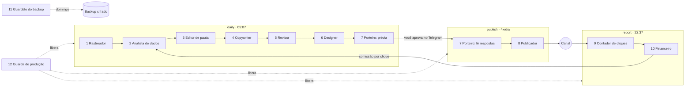

# Agentes: responsabilidades, o que existe e o que vem

No Garimpo, "agente" é uma **peça com uma responsabilidade única** no fluxo: coletar, ranquear, escrever, revisar, desenhar, publicar, medir. Hoje eles rodam como **passos determinísticos** em sequência ([src/run.py](../src/run.py)), não como um chat livre. O LLM só entra onde agrega (escrever e revisar texto) e **nunca** decide ranking, preço, link ou publicação.

- Visão de negócio: [ARQUITETURA.md](../ARQUITETURA.md)
- Configuração de cada um: [config/niches.yaml](../config/niches.yaml)
- Tabelas que cada um lê e grava: [dados.md](dados.md)

## Mapa geral

| # | Agente | Status | Usa LLM? | Passo / horário (Brasília) | Código |
|---|---|---|---|---|---|
| 1 | Rastreador | ✅ ativo | Não | `ingest`, `purge` · daily 05:07 | [pipeline/ingest.py](../src/pipeline/ingest.py) |
| 2 | Analista de dados | ✅ ativo | Não | `transform`, `score` · daily | [pipeline/transform.py](../src/pipeline/transform.py), [pipeline/score.py](../src/pipeline/score.py) |
| 3 | Editor de pauta | ✅ ativo | Não | `content` · daily | [pipeline/content.py](../src/pipeline/content.py) |
| 4 | Copywriter | ✅ ativo | Opcional (Sonnet) | `content` · daily | [content/copy.py](../src/content/copy.py) |
| 5 | Revisor | ✅ ativo | Opcional (Haiku) + regras | `content` · daily | [content/copy.py](../src/content/copy.py), [content/caption.py](../src/content/caption.py) |
| 6 | Designer | ✅ ativo (feed) | Não | `preview` / `publish` | [content/render.py](../src/content/render.py) |
| 7 | Porteiro (aprovação) | ✅ ativo | Não | `preview`, `approvals` · toda execução | [approval.py](../src/approval.py), [commands.py](../src/commands.py) |
| 8 | Publicador | ✅ ativo (Telegram) | Não | `publish` · 08:07, 12:07, 19:07, 21:07 | [publishers/telegram.py](../src/publishers/telegram.py) |
| 9 | Contador de cliques | ✅ ativo (opcional) | Não | Worker `/go` + `clicks` | [worker/src/lib.ts](../worker/src/lib.ts), [tracking/sync.py](../src/tracking/sync.py) |
| 10 | Financeiro | ✅ ativo | Não | `conversions`, `report` · 22:37 | [tracking/sync.py](../src/tracking/sync.py), [reports/daily.py](../src/reports/daily.py) |
| 11 | Guardião do backup | ✅ ativo | Não | `backup` · domingo 03:17 | [backup.py](../src/backup.py) |
| 12 | Guarda de produção | ✅ ativo | Não | job `verify` antes de toda execução | [.github/workflows/garimpo.yml](../.github/workflows/garimpo.yml) |
| — | Lojista | ⏳ fase 4 | Não | — | — |
| — | Sentinela | ⏳ parcial | Não | — | — |
| — | Caçador de cupons | ⏳ fase 5 | Sim (classificação) | — | — |
| — | Analista de mercado | ⏳ parcial (base pronta) | Sim (resumo) | — | — |
| — | Monitor de concorrentes | ⏳ fase 6 | Sim | — | — |
| — | Consultor | ⏳ fase 5 | Sim | — | — |

## Como eles se encadeiam (um dia)

O ciclo fecha no Financeiro: a comissão real por clique de cada post volta para o score do Analista de dados (componente `my_channel`), e o sistema aprende o que vende.

---

## Agentes ativos

### 1. Rastreador

| | |
|---|---|
| **Responsabilidade** | Trazer as ofertas do dia de cada nicho monitorado (`active` e `candidate`) e guardar o dado bruto |
| **Entradas** | Shopee Open API (por palavra-chave do nicho) e `config/offers/<nicho>.csv` |
| **Saídas** | `raw_offer_snapshot` (payload bruto do dia), `raw_offer_niche` (de qual nicho/palavra veio) |
| **Garantias** | Reexecutar o dia substitui, não duplica. Falha de uma palavra-chave não derruba as outras; todas falhando = falha do nicho, isolada dos outros. Nicho `candidate` sem credencial da Shopee é pulado com aviso. Snapshots com mais de 60 dias são apagados (`purge`) |
| **Configuração** | `platforms.shopee.mode/keywords/limit_per_keyword`, `manual_offers` |
| **Quando falha** | Alerta "Falhas na execução" no Telegram; os outros nichos seguem |

### 2. Analista de dados

| | |
|---|---|
| **Responsabilidade** | Limpar, historizar e ranquear os produtos de cada nicho |
| **Entradas** | Bronze do dia, histórico em `product_daily`, cliques e comissões dos posts |
| **Saídas** | `product`, `product_niche`, `product_daily`, `price_history` (SCD2), `product_score` (score, componentes, elegível, motivo de recusa, rank) |
| **Como pontua** | Média ponderada (`score_weights`) de 6 componentes em percentil dentro do nicho: **aceleração** (vendas 1d/7d), **consistência** (15d/30d), **comissão** esperada por venda, **qualidade** (nota/avaliações), **meu canal** (comissão por clique após 50 cliques) e **desconto real** (preço vs. mediana de 30 dias) |
| **Garantias** | Checagem de qualidade (preço, nota, comissão, link na allowlist); mais de 50% inválido = falha do nicho, para não ranquear lixo. Filtros: nota, avaliações, comissão mínima, faixa de preço, categorias bloqueadas (por palavra, sem acento) |
| **Configuração** | `filters`, `score_weights` |

### 3. Editor de pauta

| | |
|---|---|
| **Responsabilidade** | Decidir **quais** produtos viram post hoje e **em que horário** |
| **Regras** | `new_content_per_day` por nicho; 80% do topo do ranking + 20% de exploração (`exploration_rate`) sorteada de forma determinística entre as posições seguintes; não repete produto no nicho por `repost_cooldown_days` |
| **Saídas** | `content_item` em `ready`, com link de afiliado (subIds `[nicho, canal, post]`), legenda e horário (`publish_slots`, em rodízio) |
| **Por que a exploração** | Sem ela o sistema só posta o que já é campeão e nunca descobre o próximo |

### 4. Copywriter

| | |
|---|---|
| **Responsabilidade** | Escrever título e 2–3 bullets do post |
| **Modos** | **Template** (padrão, grátis): título do produto, nota real, "Mais de N vendidos" (arredondado para baixo) e a assinatura da marca. **Claude Sonnet** (com `ANTHROPIC_API_KEY`): texto mais vendedor, só com fatos do produto, em JSON validado |
| **Nunca escreve** | Preço, desconto, link, cupom, prazo; isso é montado pelo código |
| **Proteções** | Todo texto (template e LLM) passa por `clean_text`: remove links, @perfis, telefones, preços e promessas do vendedor ("frete grátis", "últimas unidades"). Teto de custo por nicho e global; recusa, erro ou teto atingido → template |

### 5. Revisor

| | |
|---|---|
| **Responsabilidade** | Barrar o que não pode ser publicado |
| **Camada 1: regras (sempre)** | "#publi · link de afiliado" na 1ª linha; data do preço e "sujeito a alteração"; até 1.024 caracteres; exatamente um link (o "Ver oferta"); nenhum link, @perfil ou telefone no texto; termos proibidos (cura, emagrecer, original, garantido...) |
| **Camada 2: Claude Haiku (opcional)** | Confere se o texto afirma algo que não está nos dados do produto; até 2 rodadas de correção, depois volta ao template |
| **Saída** | Post reprovado não vira `content_item` (fica no log com o motivo) |

### 6. Designer

| | |
|---|---|
| **Responsabilidade** | Gerar a arte 1080×1350 com a marca do nicho |
| **Entradas** | Foto do produto (download HTTPS, até 5 MB e 40 MP), `config/brands/*.json`, preços validados |
| **Regras** | Preço riscado e selo "-X%" **só** se o "de" foi verificado no histórico; rodapé com data, "sujeito a alteração" e "#publi" |
| **Detalhe** | A arte sobe uma vez na prévia; o Publicador reaproveita o `file_id` do Telegram (sem gerar de novo nem guardar mídia) |

### 7. Porteiro (aprovação humana)

| | |
|---|---|
| **Responsabilidade** | Garantir que nada sai sem o seu OK (ou sem a regra de autoaprovação que você ligou) |
| **Prévia** | Arte + legenda + score + motivo (topo/exploração) + horário, com botões ✅ Aprovar, ❌ Rejeitar e ⏭ Próximo horário |
| **Segurança** | Botões assinados (HMAC); só os ids de `TELEGRAM_ADMIN_USER_IDS`; prévia expira em 72 h; comandos só no chat de admin; tudo em `audit_log`; tentativas de terceiros aparecem no relatório |
| **Comandos** | `/status`, `/top <nicho>`, `/pausar <nicho> telegram`, `/retomar <nicho> telegram` |
| **Limitação atual** | As respostas são lidas no início de cada execução (ADR 0002): o botão confirma no próximo horário |
| **Autoaprovação** | `approval: auto_above_score` + `auto_approve_min_score` no nicho |

### 8. Publicador

| | |
|---|---|
| **Responsabilidade** | Publicar no canal do nicho o que foi aprovado e cujo horário chegou |
| **Garantias** | Reivindica o post antes de enviar (reexecução nunca duplica); respeita `posts_per_day`; erro confirmado do Telegram volta o post para a fila; erro ambíguo (rede) vira `publish_unknown` e gera alerta para você conferir; falha ao gerar a arte volta para a fila; 3 falhas seguidas pausam o canal (circuit breaker) e avisam; aprovados com mais de 2 dias expiram (preço velho) |

### 9. Contador de cliques (opcional)

| | |
|---|---|
| **Responsabilidade** | Contar cliques humanos por post sem coletar dado pessoal |
| **Como** | O link da legenda vira `/go/<nicho>/<canal>/<post>`; o Worker confere o destino (KV + allowlist), grava o clique no D1 e redireciona. O passo `clicks` copia para o Postgres |
| **Regras** | Sem IP e sem user-agent gravados; robôs, geradores de prévia e HEAD não contam; rate limit por IP em memória |

### 10. Financeiro

| | |
|---|---|
| **Responsabilidade** | Trazer vendas, atribuir a cada post e reportar |
| **Entradas** | `conversionReport` da Shopee (últimos 14 dias, porque o status muda) e CSV do ML/Amazon (`--import-conversions`, aceita "39,90" e "20/10/2026") |
| **Saídas** | `conversion` (atribuída por subIds a nicho, canal e post) e o relatório diário no Telegram: produtos avaliados, posts criados/publicados/pendentes, cliques, pedidos, comissão do dia e de 7 dias, **EPC** (comissão por clique), custo de LLM, falhas e eventos de segurança |

### 11. Guardião do backup

| | |
|---|---|
| **Responsabilidade** | Garantir que o histórico de vendas sobreviva a erro, invasão ou perda do projeto (o Supabase Free não faz backup) |
| **Como** | Domingo 03:17: exporta o histórico, cifra com AES-256 (`BACKUP_PASSPHRASE`), guarda 90 dias como artefato privado e apaga o arquivo aberto. Sem senha, não roda. Restauração: [runbook](runbook.md#restaurar-backup) |

### 12. Guarda de produção

| | |
|---|---|
| **Responsabilidade** | Impedir que código não verificado rode em produção |
| **Como** | Antes de toda execução, o job `verify` confere que o commit passou em `ci` e `security`; senão, bloqueia e avisa no Telegram ("⛔ Produção bloqueada"). Detalhes: [SECURITY.md](../SECURITY.md#verificação-automática-sempre) |

---

## Agentes da especificação ainda não construídos

| Agente | O que fará | O que já existe que ajuda |
|---|---|---|
| **Lojista** | Manter uma loja/página `/bio` por nicho, sempre ordenada pelo score | `product_score` pronto; falta o site (Astro) |
| **Sentinela** | Avisar quando um post performa muito acima da média ("vale impulsionar") ou abaixo | Cliques e comissão por post já existem; falta a regra e o alerta |
| **Caçador de cupons** | Achar cupons válidos (API, painel, newsletters), cruzar com o topo de cada nicho e gerar story de cupom | Fluxo de aprovação e publicação reutilizáveis |
| **Analista de mercado** | Toda semana, ranquear nichos `candidate` por crescimento, comissão e EPC estimado e abrir PR para ativar o melhor | Os 6 candidatos **já são coletados e pontuados todo dia**; falta a comparação semanal e o PR |
| **Monitor de concorrentes** | Achar produtos em alta que você ainda não postou e acompanhar perfis concorrentes (Instagram Business Discovery) | Score por nicho e histórico |
| **Consultor** | Ler o relatório e sugerir experimentos (copy, horário, nicho) com base em números | Relatório diário e `agent_run` |

---

## Ideias de novos agentes para o seu fluxo

Ordenadas pelo impacto em **receita e risco**, considerando o que já existe.

| Prioridade | Agente | Problema que resolve | Esforço | Valor |
|---|---|---|---|---|
| 1 | **Vigia de preço e estoque** | O post é aprovado de manhã e sai horas depois; se o preço subiu ou o produto acabou, você publica um preço errado (risco de propaganda enganosa e de cliques sem venda) | Baixo | Alto |
| 2 | **Calendário sazonal** | Datas como **Black Friday (27/11/2026)**, Natal e Dia das Mães concentram a maior parte das vendas do ano; hoje o sistema trata todos os dias igual | Médio | Alto |
| 3 | **Sentinela + Reciclador** | Bons posts morrem depois de publicados; produtos campeões podem voltar (com copy nova) depois do cooldown | Baixo | Alto |
| 4 | **Classificador de conformidade** | O bloqueio de categorias é por palavra: um remédio ou uma réplica com título "limpo" passa | Baixo (Haiku) | Médio-alto |
| 5 | **Otimizador de horários** | Os horários são fixos; o melhor horário varia por nicho | Médio | Médio |
| 6 | **Conciliador financeiro** | Comissão estimada ≠ comissão paga (cancelamentos, devoluções); para MEI/IR você precisa do total confirmado por mês | Baixo | Médio |
| 7 | **Analista de mercado** (spec) | Decidir com números qual nicho ativar a seguir | Médio | Médio-alto |
| 8 | **Caçador de cupons** (spec) | Cupom é o conteúdo de maior clique em achadinhos | Médio | Médio-alto |
| 9 | **Laboratório A/B de copy** | Saber qual estilo de texto vende mais por nicho | Médio | Médio |
| 10 | **Detector de link quebrado** | Produto removido da loja = clique perdido em post antigo | Baixo | Baixo-médio |

### 1. Vigia de preço e estoque *(recomendado primeiro)*

- **Quando:** no passo `publish`, logo antes de enviar.
- **O que faz:** consulta o produto na API (`productOfferV2` por `itemId`).
  - Preço subiu mais de X% (ex.: 5%) → não publica e avisa: "preço mudou de R$ 39,90 para R$ 49,90; reaprovar?".
  - Preço caiu → publica com o preço novo (legenda e arte refeitas) ou pede reaprovação, conforme a configuração.
  - Produto indisponível → cancela o post.
- **Configuração:** `price_guard: { max_increase_pct: 5, on_drop: republish | ask }` por nicho.
- **Por que primeiro:** é barato (uma chamada de API por post) e protege diretamente a conformidade ("preço consultado em...") e a taxa de conversão.

### 2. Calendário sazonal

- **Arquivo:** `config/calendar.yaml` com datas, palavras-chave extras por nicho, peso extra no score para "desconto real" e um selo na arte ("Black Friday").
- **Exemplos:** Black Friday (27/11/2026) e a semana anterior; Natal; volta às aulas (papelaria); Dia das Mães (casa/beleza); Dia do Cliente (15/09).
- **O que muda:** mais `new_content_per_day` nos dias de pico, palavras-chave sazonais na coleta e um alerta 7 dias antes ("prepare os CSVs de ML/Amazon").
- **Prazo:** a Black Friday está a ~5 semanas; vale começar já.

### 3. Sentinela + Reciclador

- **Sentinela:** no `report`, marca posts com EPC ou cliques acima de 2× a média do nicho em 7 dias ("🔥 este vendeu muito; impulsionar?") e os de desempenho zero.
- **Reciclador:** depois do cooldown, coloca de volta na pauta os campeões (com copy nova e preço reconsultado), como parte dos 80% do topo.
- **Dados:** já existem (`click_event`, `conversion`, `content_item`).

### 4. Classificador de conformidade

- **Quando:** no `score`, só para os produtos que iriam virar post (poucos por dia).
- **Como:** Claude Haiku classifica o título e a categoria em `ok | medicamento | réplica | adulto | arma | outro_proibido`, em JSON com schema. Proibido → `reject_reason` e nunca vira post.
- **Custo:** frações de centavo por dia; respeita o teto de LLM.
- **Fecha** o risco apontado em [security-review.md](security-review.md) ("categoria proibida com título limpo").

### 5. Otimizador de horários

- **Quando:** semanal.
- **Como:** cruza cliques e vendas por hora de publicação e por nicho e sugere novos `publish_slots` (com o cron correspondente) num PR, que você aprova.

### 6. Conciliador financeiro

- **Quando:** mensal (dia 5).
- **O que faz:** fecha o mês com comissão confirmada x estimada, taxa de cancelamento por nicho e um CSV para a contabilidade (MEI/IR); avisa se a taxa de cancelamento passar de 20%.

### Como um agente novo entra no sistema

1. Escreva a função do passo em `src/<área>/`, recebendo `AppContext` (e `Niche`, se for por nicho), sem `if` por nome de nicho; tudo configurável em `niches.yaml`.
2. Registre em `build_steps` ([src/run.py](../src/run.py)) e, se for agendado, inclua no alias certo (`daily`, `publish`, `report`) ou num cron novo em `garimpo.yml`.
3. Se usar LLM: saída em JSON com schema, dados externos delimitados, teto de custo (`LlmCopywriter` é o modelo) e fallback sem LLM.
4. Se publicar algo: passe pelo Porteiro (aprovação) e pelo Revisor (regras).
5. Testes com fakes (sem rede), tabelas novas com migration (RLS é exigido pelo CI) e uma linha neste documento.

Guia completo: [desenvolvimento.md](desenvolvimento.md).
