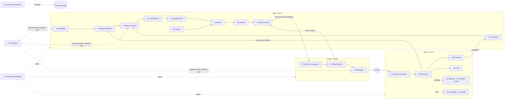

# Agentes: responsabilidades, o que existe e o que vem

No Garimpo, "agente" é uma **peça com uma responsabilidade única** no fluxo: coletar, ranquear, escrever, revisar, desenhar, publicar, medir, fiscalizar. Eles rodam como **passos determinísticos** em sequência ([src/run.py](../src/run.py)), não como um chat livre. O LLM só entra onde agrega (escrever, revisar e classificar texto) e **nunca** decide ranking, preço, link, imposto ou publicação.

- Visão de negócio: [ARQUITETURA.md](../ARQUITETURA.md)
- Configuração: [config/niches.yaml](../config/niches.yaml) (bloco `agents:`), [config/calendar.yaml](../config/calendar.yaml), [config/coupons.csv](../config/coupons.csv), [config/finance.yaml](../config/finance.yaml)
- Tabelas que cada um lê e grava: [dados.md](dados.md)

## Mapa geral

| # | Agente | Usa LLM? | Passo / horário (Brasília) | Código |
|---|---|---|---|---|
| 1 | Rastreador | Não | `ingest`, `purge` · daily 05:07 | [pipeline/ingest.py](../src/pipeline/ingest.py) |
| 2 | Analista de dados | Não | `transform`, `score` · daily | [pipeline/transform.py](../src/pipeline/transform.py), [pipeline/score.py](../src/pipeline/score.py) |
| 3 | Editor de pauta | Não | `content` · daily | [pipeline/content.py](../src/pipeline/content.py) |
| 4 | Copywriter | Opcional (Sonnet) | `content` · daily | [content/copy.py](../src/content/copy.py) |
| 5 | Revisor | Opcional (Haiku) + regras | `content` · daily | [content/copy.py](../src/content/copy.py), [content/caption.py](../src/content/caption.py) |
| 6 | Designer | Não | `preview` / `publish` | [content/render.py](../src/content/render.py) |
| 7 | Porteiro (aprovação) | Não | `preview`, `approvals` · toda execução | [approval.py](../src/approval.py), [commands.py](../src/commands.py) |
| 8 | Publicador | Não | `publish` · 08:07, 12:07, 19:07, 21:07 | [publishers/telegram.py](../src/publishers/telegram.py) |
| 9 | Contador de cliques | Não | Worker `/go` + `clicks` | [worker/src/lib.ts](../worker/src/lib.ts), [tracking/sync.py](../src/tracking/sync.py) |
| 10 | Financeiro | Não | `conversions`, `report` · 22:37 | [tracking/sync.py](../src/tracking/sync.py), [reports/daily.py](../src/reports/daily.py) |
| 11 | Guardião do backup | Não | `backup` · domingo 03:17 | [backup.py](../src/backup.py) |
| 12 | Guarda de produção | Não | job `verify` antes de toda execução | [.github/workflows/garimpo.yml](../.github/workflows/garimpo.yml) |
| 13 | Calendário sazonal | Não | `ingest`, `content`, `publish`, `report` | [agents/seasonal.py](../src/agents/seasonal.py) |
| 14 | Vigia de preço e estoque | Não | `publish`, logo antes de enviar | [agents/price_guard.py](../src/agents/price_guard.py) |
| 15 | Classificador de conformidade | Opcional (Haiku) | `content` · daily | [agents/compliance.py](../src/agents/compliance.py) |
| 16 | Caçador de cupons | Não | `content`, `publish`, `report`, `/cupons` | [agents/coupons.py](../src/agents/coupons.py) |
| 17 | Reciclador | Não | `content` · daily | [agents/sentinel.py](../src/agents/sentinel.py) |
| 18 | Sentinela | Não | `report` · 22:37 | [agents/sentinel.py](../src/agents/sentinel.py) |
| 19 | Detector de link quebrado | Não | `report` · 22:37 | [agents/links.py](../src/agents/links.py) |
| 20 | Analista de mercado | Não | `report` de domingo, `/mercado` | [agents/insights.py](../src/agents/insights.py) |
| 21 | Otimizador de horários | Não | `report` de domingo, `/horarios` | [agents/insights.py](../src/agents/insights.py) |
| 22 | Laboratório A/B de copy | Não | `content` + `report` de domingo | [agents/insights.py](../src/agents/insights.py) |
| 23 | Conciliador + Contador | Não | `report` no dia 5, `close`, `/fechamento`, `/imposto` | [agents/finance.py](../src/agents/finance.py) |

Todos os agentes 13 a 23 **só sugerem ou seguram**: nenhum muda configuração, publica sem aprovação ou move dinheiro sozinho.

## Como eles se encadeiam (um dia)

O ciclo fecha no Financeiro: a comissão real por clique de cada post volta para o score do Analista de dados (componente `my_channel`), os campeões da Sentinela voltam pela mão do Reciclador e o Contador transforma a comissão confirmada em imposto estimado e plano de retirada.

## Comandos no chat de admin

| Comando | Agente | O que responde |
|---|---|---|
| `/status` | Porteiro | Fila de aprovação e canais pausados |
| `/top <nicho>` | Analista de dados | Top 10 do score de hoje |
| `/pausar <nicho> telegram` · `/retomar <nicho> telegram` | Publicador | Pausa ou retoma o canal |
| `/cupons` | Caçador de cupons | Cupons válidos agora, por nicho |
| `/mercado` | Analista de mercado | Potencial de cada nicho e qual candidato ativar |
| `/horarios <nicho>` | Otimizador de horários | Desempenho por hora e sugestão de `publish_slots` |
| `/imposto [AAAA-MM]` | Contador | Imposto estimado, comparação de regimes, como dividir o dinheiro, riscos (padrão: mês atual) |
| `/fechamento [AAAA-MM]` | Conciliador + Contador | Fechamento completo e o CSV para a contabilidade (padrão: mês anterior) |

---

## Agentes do fluxo principal

### 1. Rastreador

| | |
|---|---|
| **Responsabilidade** | Trazer as ofertas do dia de cada nicho monitorado (`active` e `candidate`) e guardar o dado bruto |
| **Entradas** | Shopee Open API (por palavra-chave do nicho, mais as do evento sazonal ativo) e `config/offers/<nicho>.csv` |
| **Saídas** | `raw_offer_snapshot` (payload bruto do dia), `raw_offer_niche` (de qual nicho/palavra veio) |
| **Garantias** | Reexecutar o dia substitui, não duplica. Falha de uma palavra-chave não derruba as outras; todas falhando = falha do nicho, isolada dos outros. Nicho `candidate` sem credencial da Shopee é pulado com aviso. Snapshots com mais de 60 dias são apagados (`purge`) |
| **Configuração** | `platforms.shopee.mode/keywords/limit_per_keyword`, `manual_offers` |
| **Quando falha** | Alerta "Falhas na execução" no Telegram; os outros nichos seguem |

### 2. Analista de dados

| | |
|---|---|
| **Responsabilidade** | Limpar, historizar e ranquear os produtos de cada nicho |
| **Entradas** | Bronze do dia, histórico em `product_daily`, cliques e comissões dos posts |
| **Saídas** | `product`, `product_niche`, `product_daily`, `price_history` (SCD2), `product_score` (score, componentes, elegível, motivo de recusa, rank) |
| **Como pontua** | Média ponderada (`score_weights`) de 6 componentes em percentil dentro do nicho: **aceleração** (vendas 1d/7d), **consistência** (15d/30d), **comissão** esperada por venda, **qualidade** (nota/avaliações), **meu canal** (comissão por clique após 50 cliques) e **desconto real** (preço vs. mediana de 30 dias) |
| **Garantias** | Checagem de qualidade (preço, nota, comissão, link na allowlist); mais de 50% inválido = falha do nicho, para não ranquear lixo. Filtros: nota, avaliações, comissão mínima, faixa de preço, categorias bloqueadas (por palavra, sem acento) |
| **Configuração** | `filters`, `score_weights` |

### 3. Editor de pauta

| | |
|---|---|
| **Responsabilidade** | Decidir **quais** produtos viram post hoje e **em que horário** |
| **Regras** | `new_content_per_day` por nicho (multiplicado pelo Calendário em dias de pico); 80% do topo do ranking + 20% de exploração (`exploration_rate`) sorteada de forma determinística entre as posições seguintes; até 20% das vagas podem ir para campeões do Reciclador; não repete produto no nicho por `repost_cooldown_days` |
| **Saídas** | `content_item` em `ready`, com link de afiliado (subIds `[nicho, canal, post]`), legenda, horário (`publish_slots`, em rodízio), copy guardada (`copy_json`), variante A/B e cupom |
| **Por que a exploração** | Sem ela o sistema só posta o que já é campeão e nunca descobre o próximo |

### 4. Copywriter

| | |
|---|---|
| **Responsabilidade** | Escrever título e 2–3 bullets do post, na variante A ou B do Laboratório A/B |
| **Modos** | **Template** (padrão, grátis): título do produto, nota real, "Mais de N vendidos" (arredondado para baixo) e a assinatura da marca; a variante B usa outra abertura ("Olha o que eu achei: ...") e outra ordem dos fatos. **Claude Sonnet** (com `ANTHROPIC_API_KEY`): texto mais vendedor, só com fatos do produto, em JSON validado, no estilo da variante |
| **Nunca escreve** | Preço, desconto, link, cupom, prazo; isso é montado pelo código |
| **Proteções** | Todo texto (template e LLM) passa por `clean_text`: remove links, @perfis, telefones, preços e promessas do vendedor ("frete grátis", "últimas unidades"). Teto de custo por nicho e global, compartilhado com o Classificador ([common/llm.py](../src/common/llm.py)); recusa, erro ou teto atingido → template |

### 5. Revisor

| | |
|---|---|
| **Responsabilidade** | Barrar o que não pode ser publicado |
| **Camada 1: regras (sempre)** | "#publi · link de afiliado" na 1ª linha; data do preço e "sujeito a alteração"; até 1.024 caracteres; exatamente um link (o "Ver oferta"); nenhum link, @perfil ou telefone no texto; termos proibidos (cura, emagrecer, original, garantido...) |
| **Camada 2: Claude Haiku (opcional)** | Confere se o texto afirma algo que não está nos dados do produto; até 2 rodadas de correção, depois volta ao template |
| **Saída** | Post reprovado não vira `content_item` (fica no log com o motivo) |

### 6. Designer

| | |
|---|---|
| **Responsabilidade** | Gerar a arte 1080×1350 com a marca do nicho |
| **Entradas** | Foto do produto (download HTTPS, até 5 MB e 40 MP), `config/brands/*.json`, preços validados, selo do evento sazonal |
| **Regras** | Preço riscado e selo "-X%" **só** se o "de" foi verificado no histórico; rodapé com data, "sujeito a alteração" e "#publi" |
| **Detalhe** | A arte sobe uma vez na prévia; o Publicador reaproveita o `file_id` do Telegram (sem gerar de novo nem guardar mídia). Se o Vigia de preço refizer o post, a arte é gerada de novo |

### 7. Porteiro (aprovação humana)

| | |
|---|---|
| **Responsabilidade** | Garantir que nada sai sem o seu OK (ou sem a regra de autoaprovação que você ligou) |
| **Prévia** | Arte + legenda + score + motivo (topo/exploração/reciclado) + horário + variante + cupom + motivo da reaprovação (se o preço mudou), com botões ✅ Aprovar, ❌ Rejeitar e ⏭ Próximo horário |
| **Segurança** | Botões assinados (HMAC); só os ids de `TELEGRAM_ADMIN_USER_IDS`; prévia expira em 72 h; comandos só no chat de admin; tudo em `audit_log`; tentativas de terceiros aparecem no relatório |
| **Comandos** | Ver [Comandos no chat de admin](#comandos-no-chat-de-admin) |
| **Limitação atual** | As respostas são lidas no início de cada execução (ADR 0002): o botão confirma no próximo horário |
| **Autoaprovação** | `approval: auto_above_score` + `auto_approve_min_score` no nicho |

### 8. Publicador

| | |
|---|---|
| **Responsabilidade** | Publicar no canal do nicho o que foi aprovado e cujo horário chegou |
| **Garantias** | Reivindica o post antes de enviar (reexecução nunca duplica); passa pelo Vigia de preço; tira da legenda cupom que venceu; respeita `posts_per_day` (multiplicado pelo Calendário); erro confirmado do Telegram volta o post para a fila; erro ambíguo (rede) vira `publish_unknown` e gera alerta para você conferir; falha ao gerar a arte volta para a fila; 3 falhas seguidas pausam o canal (circuit breaker) e avisam; aprovados com mais de 2 dias expiram (preço velho) |

### 9. Contador de cliques (opcional)

| | |
|---|---|
| **Responsabilidade** | Contar cliques humanos por post sem coletar dado pessoal |
| **Como** | O link da legenda vira `/go/<nicho>/<canal>/<post>`; o Worker confere o destino (KV + allowlist), grava o clique no D1 e redireciona. O passo `clicks` copia para o Postgres |
| **Regras** | Sem IP e sem user-agent gravados; robôs, geradores de prévia e HEAD não contam; rate limit por IP em memória |

### 10. Financeiro

| | |
|---|---|
| **Responsabilidade** | Trazer vendas, atribuir a cada post e reportar |
| **Entradas** | `conversionReport` da Shopee (últimos 14 dias, porque o status muda) e CSV do ML/Amazon (`--import-conversions`, aceita "39,90" e "20/10/2026") |
| **Saídas** | `conversion` (atribuída por subIds a nicho, canal e post) e o relatório diário no Telegram: produtos avaliados, posts criados/publicados/pendentes, cliques, pedidos, comissão do dia e de 7 dias, **EPC** (comissão por clique), custo de LLM, falhas, eventos de segurança e a seção dos agentes (eventos, Sentinela, links, cupons vencendo). Mensagens longas são divididas em partes |

### 11. Guardião do backup

| | |
|---|---|
| **Responsabilidade** | Garantir que o histórico de vendas sobreviva a erro, invasão ou perda do projeto (o Supabase Free não faz backup) |
| **Como** | Domingo 03:17: exporta o histórico, cifra com AES-256 (`BACKUP_PASSPHRASE`), guarda 90 dias como artefato privado e apaga o arquivo aberto. Sem senha, não roda. Restauração: [runbook](runbook.md#restaurar-backup) |

### 12. Guarda de produção

| | |
|---|---|
| **Responsabilidade** | Impedir que código não verificado rode em produção |
| **Como** | Antes de toda execução, o job `verify` confere que o commit passou em `ci` e `security`; senão, bloqueia e avisa no Telegram ("⛔ Produção bloqueada"). Detalhes: [SECURITY.md](../SECURITY.md#verificação-automática-sempre) |

---

## Agentes de proteção e crescimento

### 13. Calendário sazonal

| | |
|---|---|
| **Responsabilidade** | Fazer o sistema trabalhar mais nas datas que concentram as vendas do ano |
| **Arquivo** | [config/calendar.yaml](../config/calendar.yaml): 11.11, Esquenta Black Friday, **Black Friday e Cyber Monday (27–30/11/2026)**, 12.12, Natal e Dia das Mães 2027 |
| **Num evento ativo** | O Rastreador busca as palavras-chave extras do nicho; Editor de pauta e Publicador multiplicam o volume (`content_multiplier`, até 3×); arte e legenda ganham o selo (`badge`) |
| **Aviso prévio** | `heads_up_days` antes de começar, o relatório avisa: "🗓 Black Friday começa em 7 dias: prepare ofertas de ML/Amazon no CSV" |
| **Adicionar uma data** | Só configuração: copie um evento, mude `id`, datas e nichos. `niches` vazio = todos. O `validate` recusa nicho inexistente |

### 14. Vigia de preço e estoque

| | |
|---|---|
| **Responsabilidade** | Não publicar preço errado nem produto esgotado (risco de propaganda enganosa e de clique sem venda) |
| **Quando** | No `publish`, depois de reivindicar o post e antes de enviar |
| **Como** | Consulta o produto na Shopee (`productOfferV2` por `itemId`) e compara com o preço da criação do post |
| **Decisão** | Preço igual (dentro de `tolerance_pct`, padrão 2%) → publica. Preço mudou (subiu **ou** caiu) → refaz legenda e arte com o preço novo e volta para a **sua reaprovação**, com o motivo na prévia ("preço mudou de R$ 39,90 para R$ 49,90"). Indisponível → status `unavailable`, não publica. Um alerta por execução resume o que foi segurado |
| **Falha na consulta** | Publica (o preço tem menos de 2 dias e a legenda diz "sujeito a alteração"); a falha fica no log. Ofertas manuais (CSV de ML/Amazon) não são consultadas |
| **Configuração** | `agents.price_guard.enabled`, `agents.price_guard.tolerance_pct` |

### 15. Classificador de conformidade

| | |
|---|---|
| **Responsabilidade** | Barrar produto proibido com título "limpo" que o filtro por palavra deixa passar (remédio, réplica, adulto, arma, tabaco/álcool) |
| **Quando** | No `content`, só para os produtos que iriam virar post (poucos por dia) |
| **Como** | Claude Haiku classifica título e categoria em `ok`, `medicamento`, `replica`, `adulto`, `arma`, `tabaco_alcool` ou `outro_proibido`, em JSON com schema. Proibido → não vira post e conta como "bloqueado" no log. O veredito fica em `compliance_check` (o mesmo produto não é pago duas vezes) |
| **Sem LLM** | Sem `ANTHROPIC_API_KEY`, com teto de custo atingido ou erro na chamada, valem só as regras por palavra (`filters.blocked_categories`) e o Revisor |
| **Custo** | Frações de centavo por dia; entra no mesmo teto de LLM do Copywriter |
| **Configuração** | `agents.compliance_llm` |

### 16. Caçador de cupons

| | |
|---|---|
| **Responsabilidade** | Pôr o melhor cupom válido no post: cupom é o conteúdo de maior clique em achadinhos |
| **Arquivo** | [config/coupons.csv](../config/coupons.csv): `platform,code,description,discount_pct,discount_brl,min_purchase,valid_until,niches`. Você cola os cupons do painel de afiliado ou das newsletters (não há API pública de cupons) |
| **Como** | No `content`, escolhe para cada produto o cupom da mesma loja e nicho, válido e com compra mínima atendida, que mais economiza, e põe uma linha na legenda ("🎟 Cupom ABC10: 10% off (até 31/10 23:59)"). No `publish`, se o cupom venceu, a linha sai da legenda |
| **Relatório** | Avisa cupons que vencem nas próximas 24 h; `/cupons` lista os válidos |

### 17. Reciclador

| | |
|---|---|
| **Responsabilidade** | Trazer de volta os campeões depois do cooldown, em vez de deixá-los morrer |
| **Como** | No `content`, pega produtos de posts dos últimos `lookback_days` (60) que já geraram comissão (os que mais venderam primeiro), que já cumpriram o `repost_cooldown_days` e ainda são elegíveis no score de hoje. Ocupam até `max_share` (20%) das vagas do dia, com copy nova, preço novo e motivo "reciclado" na prévia |
| **Configuração** | `agents.recycle.enabled/max_share/lookback_days` |

### 18. Sentinela

| | |
|---|---|
| **Responsabilidade** | Avisar o que está indo muito bem ou muito mal nos posts dos últimos 7 dias |
| **Como** | No `report`, marca como 🔥 os posts com comissão de pelo menos `winner_multiplier` (2×) a média do nicho, ou cliques de 2× a média com pelo menos `min_clicks` (20) ("vale impulsionar"), e como 💤 os publicados há 3 dias ou mais sem nenhum pedido (e sem clique, se o `/go` estiver ativo) |
| **Configuração** | `agents.sentinel.winner_multiplier/min_clicks` |

### 19. Detector de link quebrado

| | |
|---|---|
| **Responsabilidade** | Achar posts publicados cujo produto saiu da loja (clique perdido) |
| **Como** | No `report`, confere até 40 posts dos últimos 30 dias por execução: na Shopee pela API; nas outras lojas com um pedido HTTP ao link. Link quebrado → aviso no relatório e `status_reason = 'link quebrado'` no post (cada post é avisado uma vez). Erro na checagem de um post não derruba os outros |
| **Configuração** | `agents.broken_links` |

### 20. Analista de mercado

| | |
|---|---|
| **Responsabilidade** | Decidir com números qual nicho ativar a seguir |
| **Como** | Todo domingo (e em `/mercado`) compara todos os nichos, ativos e `candidate` (que já são coletados e pontuados todo dia), pelo **potencial semanal**: soma de vendas em 7 dias × preço × comissão dos 20 melhores produtos elegíveis. Sugere ativar o candidato cujo potencial supera a média dos ativos, com o passo exato ([SETUP.md §16.2](SETUP.md)) |

### 21. Otimizador de horários

| | |
|---|---|
| **Responsabilidade** | Achar o melhor horário de cada nicho |
| **Como** | Todo domingo (e em `/horarios <nicho>`) cruza cliques e comissão por hora de publicação dos últimos 28 dias. Com 8 posts ou mais, sugere novos `publish_slots` e o cron correspondente do `garimpo.yml` (em UTC). Você aplica no YAML; ele não muda nada sozinho |

### 22. Laboratório A/B de copy

| | |
|---|---|
| **Responsabilidade** | Descobrir qual estilo de texto vende mais por nicho |
| **Como** | No `content`, cada post recebe a variante A ou B por um hash do id (divisão 50/50 estável). Todo domingo o relatório compara cliques e comissão por post de cada variante em 28 dias e aponta a vencedora quando há 10 posts ou mais de cada uma e diferença de 20% ou mais |
| **Configuração** | `agents.ab_test` (desligado = todos na variante A) |

### 23. Conciliador + Contador (trabalham com o Financeiro)

> ⚠️ **Estimativas para planejamento, não consultoria contábil.** As regras estão em [config/finance.yaml](../config/finance.yaml), com data e fonte. Regime, CNAE e cálculo final precisam ser validados por um contador.

| | |
|---|---|
| **Conciliador** | Fecha o mês: pedidos, vendas, comissão **confirmada x pendente x cancelada**, taxa de cancelamento, por loja e por nicho, e manda um **CSV para a contabilidade** (abre no Excel) |
| **Contador** | A partir da comissão **confirmada** do mês e dos últimos 12 meses (RBT12), estima o imposto no seu regime e compara com as alternativas, sugere como dividir o dinheiro e aponta otimizações e riscos |
| **Quando** | Automático no relatório do dia `dia_fechamento` (5) para o mês anterior; a qualquer hora com `/imposto` (mês atual, parcial) e `/fechamento`; ou `--steps close --month AAAA-MM` |
| **Regimes comparados** | Simples Anexo III, Simples Anexo V, Simples III via **Fator R** (pró-labore ≥ 28% da receita, nunca menor que 1 salário mínimo, com INSS de 11% e IR do pró-labore no custo), MEI (só se `mei_permitido: true`) e pessoa física (tabela mensal com a redução de 2026) |
| **Divisão do dinheiro** | Reserva para impostos (imposto + 10% de margem) → custos fixos e de IA → do que sobra: 20% reinvestimento, 10% caixa de emergência, o resto é a retirada sugerida (ou `retirada_alvo_mensal`, se você definir) |
| **Riscos que aponta** | 80%/100%/120% do limite do MEI; projeção anual acima do limite; mais de 80% da receita numa loja só; cancelamento acima de 20%; muito dinheiro pendente; queda de 30% ou mais no mês; custos acima de 10% da receita; retirada acima de R$ 50 mil/mês (retenção de 10% sobre dividendos); `finance.yaml` com mais de 1 ano |

#### Exemplo: "faturei R$ 50 mil no mês"

Simulação com as regras de 2026 do `finance.yaml`, considerando R$ 50 mil/mês de comissão confirmada há 12 meses (RBT12 = R$ 600 mil):

| Regime | Imposto do mês | Observação |
|---|---|---|
| Simples Anexo V | R$ 8.925 (17,9%) | onde afiliado costuma cair sem Fator R |
| Simples III via Fator R | R$ 8.897 | DAS de R$ 5.280 + INSS R$ 932 + IR R$ 2.685 sobre um pró-labore de R$ 14.000 |
| Pessoa física | R$ 12.674 (25,3%) | tabela progressiva |
| MEI | não aplicável | passa do limite de R$ 81 mil/ano e afiliado pode não ser permitido no MEI |

Divisão sugerida (regime Anexo V, sem custos fixos): reserva de impostos **R$ 9.818**, reinvestimento **R$ 8.037**, caixa **R$ 4.018**, retirada **R$ 28.128**.

O que o Contador explica nesse caso:

- **Reinvestir não abate imposto no MEI nem no Simples.** O imposto é calculado sobre a receita bruta, então reinvestir R$ 20 mil não reduz o DAS. Reinvista porque dá retorno (por exemplo, impulsionar os posts 🔥 da Sentinela), não para pagar menos imposto. Despesa só abate imposto no Lucro Presumido/Real, que não compensa nessa faixa.
- **O que reduz imposto legalmente é o regime certo.** Em R$ 50 mil/mês o Fator R quase empata com o Anexo V (o IR do pró-labore alto come a economia). Em R$ 5–15 mil/mês, o Fator R costuma economizar algumas centenas de reais por mês. O agente só recomenda mudança quando a economia passa de R$ 50/mês.
- **Retirada:** o pró-labore entra na retirada. Acima de R$ 50 mil/mês de lucros da mesma empresa, há retenção de 10% sobre o total.

#### O que você precisa configurar

1. Com o contador: confirme o regime e o anexo, e ajuste `regime`, `simples.anexo` e `mei_permitido`.
2. `folha_12m` (pró-labore pago nos últimos 12 meses) e `custos_fixos_mensais`.
3. Revise as alíquotas todo janeiro e atualize `atualizado_em`.

---

## Ideias de agentes futuros

| Agente | O que fará | O que já existe que ajuda |
|---|---|---|
| **Lojista** | Manter uma loja/página `/bio` por nicho, sempre ordenada pelo score | `product_score` pronto; falta o site (Astro) |
| **Monitor de concorrentes** | Achar produtos em alta que você ainda não postou e acompanhar perfis concorrentes (Instagram Business Discovery) | Score por nicho e histórico |
| **Consultor** | Ler o relatório e sugerir experimentos (copy, horário, nicho) em linguagem natural | Sentinela, Analista de mercado, Otimizador e A/B já calculam os números |
| **Aprovação instantânea** | Webhook do Telegram (Cloudflare Worker) para o botão agir na hora, em vez de no próximo horário | ADR 0002 descreve a troca |
| **Publicador Instagram/WhatsApp** | Mais canais além do Telegram | Arte, legenda e aprovação reutilizáveis |

### Como um agente novo entra no sistema

1. Escreva o módulo em `src/agents/` (ou na área certa), recebendo `AppContext` (e `Niche`, se for por nicho), sem `if` por nome de nicho; tudo configurável em `niches.yaml` (bloco `agents:`) ou num arquivo próprio em `config/` validado por `src.config.validate`.
2. Registre em `build_steps` ([src/run.py](../src/run.py)) ou chame a partir de um passo existente; se for agendado, inclua no alias certo (`daily`, `publish`, `report`) ou num cron novo em `garimpo.yml`.
3. Se usar LLM: passe pelo `LlmGateway` ([common/llm.py](../src/common/llm.py)): saída em JSON com schema, teto de custo, registro em `agent_run` e fallback sem LLM.
4. Se publicar algo: passe pelo Porteiro (aprovação) e pelo Revisor (regras).
5. Testes com fakes (sem rede), tabelas novas com migration (RLS é exigido pelo CI) e uma linha neste documento.

Guia completo: [desenvolvimento.md](desenvolvimento.md).
