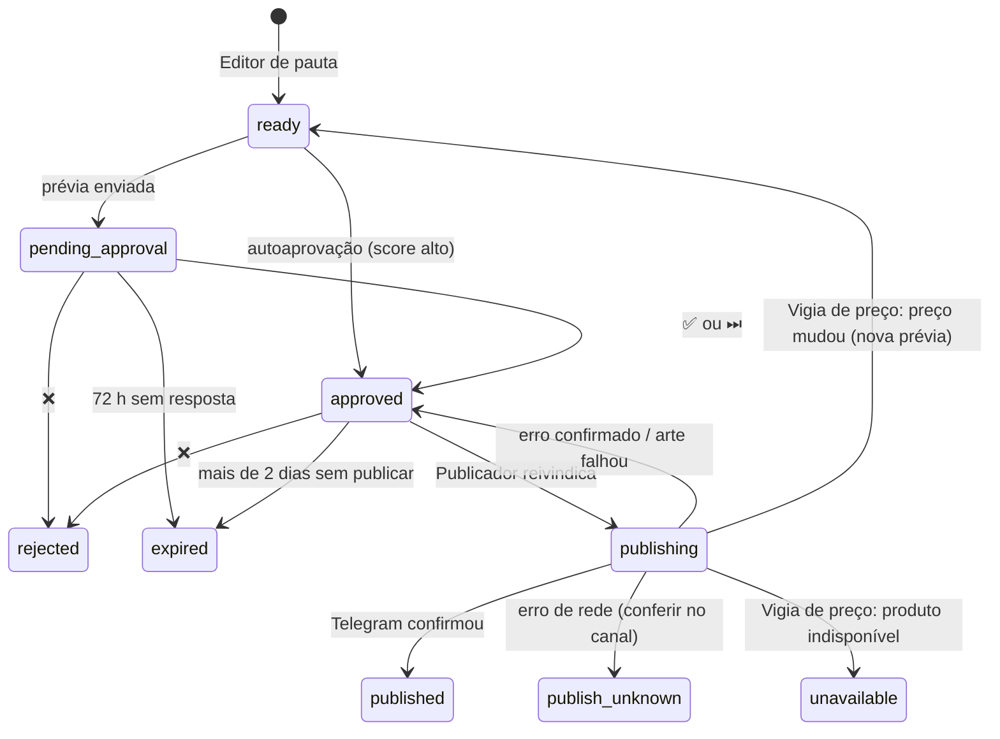

# Dicionário de dados

Banco: Postgres (Supabase) em produção, schema `garimpo`; SQLite na demo e nos testes. Estrutura em [sql/migrations/](../sql/migrations/).

**Convenções**
- Datas são `TEXT` no formato `AAAA-MM-DD`; instantes são `TEXT` ISO-8601 em UTC (ex.: `2026-10-20T11:07:00+00:00`). Os dois ordenam corretamente como texto ([ADR 0004](adr/0004-sql-portavel-e-sqlite-na-demo.md)).
- Ids são gerados no código. `content_item.id` é determinístico (mesmo nicho + produto + canal + dia = mesmo id), o que torna a criação de posts idempotente.
- RLS está ligado em **todas** as tabelas (o CI reprova migration nova sem RLS). O pipeline (`app_writer`) não pode apagar vendas, cliques, posts nem auditoria.

## Visão por camada

| Camada | Tabelas | Quem grava | Retenção |
|---|---|---|---|
| Bronze (bruto) | `raw_offer_snapshot`, `raw_offer_niche` | Rastreador | 60 dias (`purge`) |
| Silver (limpo) | `product`, `product_niche`, `product_daily`, `price_history` | Analista de dados | Indefinida |
| Gold (decisão) | `product_score`, `compliance_check` | Analista de dados, Classificador de conformidade | Indefinida (substituída por dia) |
| Conteúdo | `content_item` | Editor de pauta, Porteiro, Publicador, Vigia de preço, Detector de links | Indefinida, sem DELETE |
| Medição | `click_event`, `conversion` | Contador de cliques, Financeiro | Indefinida, sem DELETE |
| Operação | `niche`, `agent_run`, `pipeline_run`, `audit_log`, `channel_state`, `kv_state`, `schema_migrations` | Vários | Indefinida (`audit_log` somente-inclusão) |

## Tabelas

### `raw_offer_snapshot`: oferta bruta do dia
| Coluna | Descrição |
|---|---|
| `run_date`, `platform`, `item_id` | Chave: dia, loja (`shopee`, `mercadolivre`, `amazon`), id na loja |
| `payload` | JSON da oferta como veio da fonte (normalizado em `Offer`) |
| `fetched_at` | Quando foi coletada |

### `raw_offer_niche`: de qual nicho/palavra-chave veio cada oferta do dia
`run_date`, `platform`, `item_id`, `niche_id`, `keyword` (`manual` para CSV). Uma oferta pode aparecer em vários nichos.

### `product`: estado atual de cada produto
| Coluna | Descrição |
|---|---|
| `id` | `<platform>:<item_id>` |
| `title`, `image_url`, `product_url`, `affiliate_url`, `shop_name`, `category` | Dados do anúncio (escritos pelo vendedor: tratados como não confiáveis) |
| `rating`, `reviews`, `sales_total`, `commission_rate` | Métricas da loja (podem ser nulas na fonte manual) |
| `price`, `price_original` | Preço atual e o "de" **declarado pelo vendedor** (não é exibido sem verificação) |
| `first_seen`, `last_seen` | Primeiro e último dia em que apareceu |

### `product_niche`: produto ↔ nicho
`product_id`, `niche_id`, `keyword`, `first_seen`, `last_seen`.

### `product_daily`: foto diária (base das janelas de venda)
`product_id`, `run_date`, `price`, `sales_total`, `rating`, `commission_rate`. Vendas em N dias = `sales_total` de hoje − o de N dias atrás.

### `price_history`: histórico de preço (SCD2)
`product_id`, `valid_from`, `valid_to` (NULL = vigente), `price`. Usado no componente "desconto real" e na verificação do "de/por".

### `product_score`: ranking do dia por nicho
| Coluna | Descrição |
|---|---|
| `niche_id`, `product_id`, `run_date` | Chave |
| `score` | 0 a 1, média ponderada dos componentes |
| `components` | JSON: `acceleration`, `consistency`, `commission`, `quality`, `my_channel`, `real_discount` e `sales_1d/7d/15d/30d` |
| `eligible`, `reject_reason` | Passou nos filtros? Se não, por quê (nota, comissão, preço, categoria bloqueada) |
| `rank` | Posição entre os elegíveis (1 = melhor) |

### `content_item`: cada post
| Coluna | Descrição |
|---|---|
| `id` | Id curto e determinístico; vai no subId da Shopee e no `/go` |
| `niche_id`, `product_id`, `channel`, `run_date` | Únicos juntos: um post por produto/canal/dia |
| `status` | Ver a máquina de estados abaixo |
| `score`, `pick_reason` | Score no dia e `top`, `exploration` ou `recycled` (Reciclador) |
| `caption`, `copy_source` | Legenda final (HTML do Telegram) e `template` ou `llm` |
| `copy_json`, `copy_variant` | Título/bullets/hashtags em JSON (o Vigia de preço refaz a legenda sem chamar o LLM) e a variante `A`/`B` do Laboratório A/B |
| `coupon_code` | Cupom anunciado na legenda (Caçador de cupons); sai se vencer antes de publicar |
| `status_reason` | Motivo da última mudança feita por um agente: "preço mudou de R$ 39,90 para R$ 49,90", "produto indisponível na loja", "link quebrado" |
| `affiliate_url`, `tracked_url` | Link de afiliado e o link usado na legenda (`/go` se configurado) |
| `price_at_creation`, `price_original_shown` | Preço do post e o "de" exibido (só se verificado; NULL = sem riscado) |
| `scheduled_for` | Horário de publicação (UTC) |
| `media_file_id`, `preview_message_id`, `external_id` | Foto no Telegram (reaproveitada), mensagem da prévia, mensagem no canal |
| `created_at`, `updated_at`, `published_at` | Instantes |

**Máquina de estados**

### `compliance_check`: veredito do Classificador de conformidade
| Coluna | Descrição |
|---|---|
| `product_id` | Produto (um veredito por produto; não paga o LLM duas vezes) |
| `verdict` | `ok`, `medicamento`, `replica`, `adulto`, `arma`, `tabaco_alcool` ou `outro_proibido` |
| `reason`, `model`, `checked_at` | Justificativa curta, modelo usado e quando |

### `click_event`: cliques (sem dado pessoal)
`id` (`d1:<n>`), `ts`, `niche_id`, `channel`, `content_id`, `country` (2 letras). Sem IP nem user-agent.

### `conversion`: vendas
| Coluna | Descrição |
|---|---|
| `id` | `<platform>:<conversão>:<pedido>:<item>` (atualiza em vez de duplicar) |
| `order_id`, `item_id`, `purchase_time` | Pedido, item, quando foi comprado (UTC) |
| `status`, `amount`, `commission` | Status na loja, valor e comissão (estimada até concluir; `cancelled`/`invalid` não entram no relatório) |
| `niche_id`, `channel`, `content_id` | Atribuição pelos subIds (nulos se o link não era do sistema) |
| `raw` | Referências originais |

### Operação
| Tabela | O que guarda |
|---|---|
| `niche` | Espelho do `niches.yaml` a cada execução (`config_json`) |
| `agent_run` | Cada chamada de LLM (Copywriter, Revisor, Classificador): agente, modelo, tokens, custo US$, latência, status. Base do teto de custo diário e do custo de IA no Contador |
| `pipeline_run` | Cada passo por nicho em cada execução: `running`/`ok`/`failed` e detalhe |
| `audit_log` | Ações administrativas e de segurança: aprovações, pausas, autoaprovação, circuit breaker, tentativas de terceiros (`tg:<id>`), falhas de atualização |
| `channel_state` | Por nicho e canal: `paused` e falhas seguidas (circuit breaker) |
| `kv_state` | Marcadores: offset do Telegram (`telegram_update_offset`), cliques já copiados do D1 (`d1_click_watermark`) |
| `schema_migrations` | Migrations aplicadas |

## Views (só Postgres, para consulta)

| View | Uso |
|---|---|
| `v_daily_niche` | Por dia e nicho: produtos pontuados, elegíveis, melhor score |
| `v_content_performance` | Por post: status, score, título, preço, cliques, pedidos, comissão |

Exemplos de consulta: [runbook.md → Consultas úteis](runbook.md#consultas-úteis).
